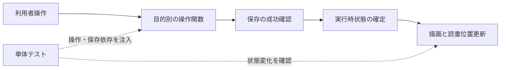

# 状態遷移と依存関係

この資料は、主な利用者操作について保存・実行時状態・描画・検証の流れを対応付ける。実装の正本は[`hitohira.html`](../hitohira.html)、利用者から見える動作の正本は[仕様書](./SPECIFICATION.md)、検証範囲の正本は[カバレッジ表](./coverage_matrix.md)とする。関数名は実装を探す手掛かりであり、公開APIではない。

## 状態変更の流れ

| 操作 | 保存の境界 | 実行時状態の確定 | 描画・後続処理 | 主な検証 |
|---|---|---|---|---|
| 設定変更 | `commitSettings`が状態を即時更新し、`saveSettings`が最新JSONを250 ms後に保存する。Web Locks対応時は取得可能性をポーリングし、10秒で打ち切る同じ排他ロックを複数データ保存と使う。 | 画面操作時に設定オブジェクトを更新する。保存の進行・成功・失敗を設定ドロワーへ表示する。 | `applySettings`、書字方向が変わった場合の読書位置復元、読書状態更新。 | 遅延保存、ロック再試行と一度の実行、失敗状態表示、別タブ変更後の書込停止、設定の正規化。 |
| 本文インポート | `handleFiles`が構造化された取込結果を更新し、本文・位置・しおり・設定とIndexedDBの元Blobを再実行可能な保存操作として`commitSavedData`へ渡す。 | 保存成功後に`applyImportedTextState`が題名・元Blob・拡張子を更新する。 | `displayViewerContent`で安全な本文を表示し、目次・検索・しおり・読書位置を更新する。 | 単一・複数ファイル、混在入力の部分成功、保存失敗時の既存本文・設定・元ファイル保持。 |
| 背景メディアインポート | `importBackgroundMedia`が画像・動画を検証してからIndexedDBへ保存する。 | 保存成功後に元Blob・拡張子を設定する。表示URL、媒体種別、Blob、寸法、移動量、読み込み済み画像は`backgroundMediaState`でまとめて管理する。 | `applyBackgroundImage`で表示し、エクスポートボタンを更新する。 | 画像寸法、動画メタデータ、保存失敗時の旧メディア保持、状態の初期化と更新。 |
| 元ファイル削除 | `removeImportedText`または`removeBackgroundMedia`が`changeSavedData`を通じてLocalStorageとIndexedDBを更新する。小さな未完了マーカーを置いて複数保存の意図をDBへ記録し、起動時に`recoverSavedDataTransaction`が未完了操作を再適用する。 | 永続化成功後に該当する実行時Blob・題名・本文を更新する。 | 本文削除では`displayViewerContent`、媒体削除では背景表示を更新し、ダウンロード行を再描画する。 | 削除の中断・拒否時に表示と保存データを保持し、中断記録があれば次回起動で収束すること。 |
| 設定初期化 | `resetViewerState`が設定・本文・位置・しおりと元ファイルを保存領域から削除する。 | 削除成功後に設定・Blob・背景状態を既定値へ戻す。 | `applySettings`、`displayViewerContent`、ドロワー閉鎖。 | 通常版・エクスポート版の初期化、失敗時保持、HTML内蔵データを維持すること。 |
| ドロワー操作 | `setActiveDrawer`が設定・目次・検索の排他状態を切り替え、対応ボタンの`aria-expanded`とパネルの`aria-hidden`・`inert`を同期する。 | 最後に開いたトリガーを保持する。設定・目次ではパネル、検索では検索入力へフォーカスする。 | 閉鎖時はトリガーが閉じたドロワー内なら常時表示の設定ボタンへ、それ以外は最後のトリガーへ戻す。切替時は新しいドロワーをアクティブにする。 | 排他開閉、ARIA状態、閉鎖パネルの操作除外、フォーカス対象と復帰先。 |
| 起動 | 通常版では設定・本文を読む前に`recoverSavedDataTransaction`が未完了のLocalStorage・IndexedDB操作を再適用する。その後`restoreInitialSettings`が設定を読み、`restoreInitialContent`が本文を選ぶ。IndexedDBとHTML内蔵データは後続の`restoreDeferredData`で読む。 | 保存値を正規化して設定へ反映し、表示言語は毎回ブラウザー優先言語から独立して決定する。本文はサニタイズし、復旧失敗時は整合しない値を読み込まず通知する。 | 言語適用後に設定と`displayViewerContent`を描画し、その後背景・元ファイル・読書位置を復元する。 | 初回・部分保存・破損設定、中断保存の再実行、優先言語を変えた再起動、保存本文、遅延データ復元の順序。 |
| 目次・しおり・検索 | しおり追加・削除は個別操作でLocalStorageへ保存する。検索条件と目次は実行時データ。 | `collectTableOfContentsEntries`が見出しモデルを作る。検索と目次描画は大量時に分割し、世代番号で古い処理を破棄する。 | `renderNavigationViews`が目次・しおり・検索結果を必要な範囲で描画する。 | 見出しなし、選択移動、現在位置、しおり保存・削除失敗、検索結果選択、大量項目時の古い描画破棄。 |

## エクスポートデータ

`createEmbeddedResetDefaults`と`createEmbeddedDownloadData`がスキーマ版付きのJSONを作る。`serializeEmbeddedJson`がHTML内で安全な文字列へ直列化し、`readEmbeddedResetDefaults`と`readEmbeddedDownloadData`が版・型・値を検証してから復元へ渡す。版番号のない既存ファイルは旧形式として読み、未知の版は初期化既定値へ戻すか復元失敗として通知する。

## 変更時の確認

状態変更に触れるときは、上表の該当行から保存失敗・実行時状態・描画を確認する。内蔵データ形式を変更するときは、旧版入力と未知版入力を含めて復元処理・仕様・テストを同じ変更で更新する。DOMレイアウト、ブラウザー標準API、実際のファイル操作をVM単体テストで保証できない場合は、明示依頼のあるブラウザー操作テストで補う。
