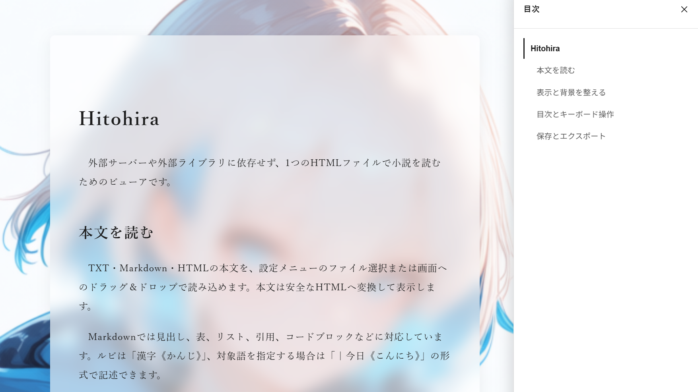

[日本語](../../README.md) | [English](../en/README.md) | [Español](../es/README.md) | [简体中文](../zh-Hans/README.md) | [繁體中文](../zh-Hant/README.md) | [Français](../fr/README.md) | [Deutsch](./README.md) | [Português](../pt/README.md) | [한국어](../ko/README.md) | [Русский](../ru/README.md) | [हिन्दी](../hi/README.md) | [العربية](../ar/README.md)

  

# Hitohira

Ein eigenständiger Roman-Reader, der mit einer einzigen HTML-Datei läuft. Unterstützt den Import von TXT-, Markdown- und HTML-Dateien, vertikale und horizontale Leserichtung, Hintergrundbilder und -videos, ein Inhaltsverzeichnis, gespeicherte Lesepositionen und den HTML-Export.

Die Benutzeroberfläche richtet sich nach der bevorzugten Browsersprache und ist auf Japanisch, Englisch, vereinfachtem und traditionellem Chinesisch, Spanisch, Französisch, Deutsch, Portugiesisch, Koreanisch, Russisch, Arabisch und Hindi verfügbar.

## Bildschirmfotos

  

  

## Download

[Hitohira herunterladen](https://github.com/z0w1non/Hitohira/raw/HEAD/public/hitohira-de.html?download=1)

Öffne die heruntergeladene HTML-Datei in einem Browser. Für die Nutzung des Readers ist keine Internetverbindung erforderlich.

## Ruby-Annotationen

Verwenden Sie HTML wie `<ruby>Text<rt>Anmerkung</rt></ruby>` für eine Annotation. Verwenden Sie in TXT und Markdown die Tags `ruby`, `rt` und `rp` ohne Attribute. Die japanische Oberfläche unterstützt außerdem `｜今日《こんにち》` und `漢字《かんじ》。
