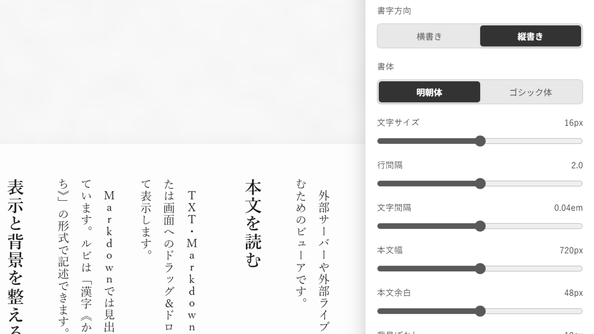

[日本語](../../README.md) | [English](../en/README.md) | [Español](../es/README.md) | [简体中文](../zh-Hans/README.md) | [繁體中文](./README.md) | [Français](../fr/README.md) | [Deutsch](../de/README.md) | [Português](../pt/README.md) | [한국어](../ko/README.md) | [Русский](../ru/README.md) | [हिन्दी](../hi/README.md) | [العربية](../ar/README.md)

  

# Hitohira

可透過單一 HTML 檔案執行的獨立小說閱讀器。支援匯入 TXT、Markdown 和 HTML 檔案、橫排或直排閱讀、設定背景圖片或影片、瀏覽目錄、儲存閱讀位置，以及匯出為 HTML。

介面會依照瀏覽器的偏好語言切換，支援日文、英文、簡體中文、繁體中文、西班牙文、法文、德文、葡萄牙文、韓文、俄文、阿拉伯文和印地文。

## 螢幕截圖

  

  

## 下載

[下載 Hitohira](https://github.com/z0w1non/Hitohira/raw/HEAD/public/hitohira-zh-tw.html?download=1)

在瀏覽器中開啟下載的 HTML 檔案即可。使用閱讀器時不需要連線至網路。

## 注音

使用 `<ruby>正文<rt>注音</rt></ruby>` 這類 HTML 加入注音。TXT 和 Markdown 中請使用不含屬性的 `ruby`、`rt`、`rp` 標籤。日文介面亦支援 `｜今日《こんにち》` 和 `漢字《かんじ》`。
